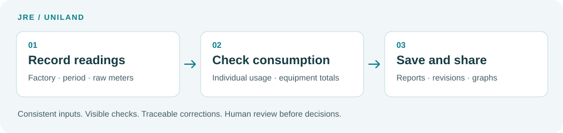
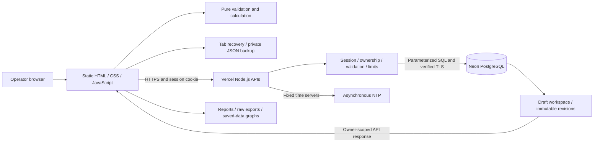

<p align="center"></p>

# Midea Daily Energy Report

<p align="center">
  <a href="https://developer.mozilla.org/en-US/docs/Web/JavaScript"></a>
  <a href="https://nodejs.org/"></a>
  <a href="https://vercel.com/docs"></a>
  <a href="https://neon.com/docs"></a>
</p>

**v0.11.17-alpha** · JRE / UNILAND · made in <3 by gede

[Open website](https://midea-jre.vercel.app/) · [English](#english) · [简体中文](#简体中文) · [Indonesia](#indonesia) · [Changelog](CHANGELOG.md) · [Security](SECURITY.md) · [Rights reserved](LICENSE)

## English

A table-based energy reporting tool for Midea JRE and UNILAND operators. Enter cumulative meter readings, review consumption, save account-owned history, and copy a factory report, raw reading list or Excel row.

The intended contribution to Midea Business System work is practical: consistent recording, visible checks, traceable corrections and comparable energy trends. Managers can use the output in their daily reviews and improvement work. This repository does not claim official MBS approval or certification. It remains an **alpha reporting tool**, requiring human review before figures are used for decisions.



### Operator quick start

1. Sign in with the account provided by your admin. Change a temporary password when prompted.
2. Choose **JRE / UNILAND**, recording mode, and actual reading dates/times.
3. Enter cumulative readings. Decimal comma or dot is accepted, without thousands separators. Text import is optional. Use `-` for explicitly unavailable readings; blank means unfinished.
4. Review individual usage, equipment totals and check notes. Complete required fields before copying a finished report.
5. Choose the final report sections, copy the report or Excel row, and **Save report** for historian and graphs. A correction creates a revision; old saved output is retained.

| Mode             | Reading interval, editable times                  | Report date |
| ---------------- | ------------------------------------------------- | ----------- |
| 24 HOURS         | Morning D → morning D+1, normally 08:00–08:00 WIB | D           |
| AFTER PRODUCTION | Morning D → evening D, normally 08:00–17:00 WIB   | D           |
| NIGHT SHIFT      | Evening D → morning D+1, normally 17:00–08:00 WIB | D           |

Only observations with the same factory, date and time are shared. Unknown readings stay blank. Final copy offers five choices: 24 HOURS; 24 HOURS + AFTER PRODUCTION; all three; AFTER PRODUCTION only; NIGHT SHIFT only. Gas, Water and existing manual utilities are calculated separately for each period and appear in each selected section. Matching gas/Water observations are shared; refill lists and manual totals belong to their period. Save and Excel row follow the active recording mode. See [periods and shifts](docs/working-hours.md).

### Everyday features

The welcome screen uses a white layout, brief English/Chinese/Indonesian copy and lightweight logo motion. Pause/replay and reduced motion are supported; decoration stops after sign-in and never gates the form. Welcome credit: Made with ❤️ by gedxxe for Midea JRE Engineering Department. See [welcome design and motion](docs/welcome.md).

**Quick guide** in the Account panel explains eight essential workflows with animated cursor illustrations. The small invitation can be dismissed; reopen the guide whenever needed. Back/Next, Escape/Close, animation pause and reduced-motion support are included. Illustrations never change your readings or save data. Guide code, styles and longer translations load only when opened; the dismissal preference stays in this browser per account.

| Need                               | Where and how                                                                                                                                                                                                                                                                                                                                                                           |
| ---------------------------------- | --------------------------------------------------------------------------------------------------------------------------------------------------------------------------------------------------------------------------------------------------------------------------------------------------------------------------------------------------------------------------------------- |
| Send readings without calculations | **Export Raw Table Data**, beside the electricity table. Choose Start or End; only that column must be complete. Excludes gas, Water and JRE T1–T4.                                                                                                                                                                                                                                     |
| Prepare for an outage              | **Blank reading template**, beside raw export after login or on the sign-in card before login. Copy/download a schema-only `.txt` with `____` and `DD/MM/YYYY`, then keep it outside the website. Contains no saved readings; no duplicate in the footer.                                                                                                                               |
| Keep unfinished work               | One replaceable workspace per account covers both factories and all three modes. Immediate tab recovery; server sync after 30 seconds idle or 120 seconds continuous editing. Check the account save time before closing. Conflicts require an explicit choice.                                                                                                                         |
| Keep a portable backup             | **Draft backup and restore** downloads owner-bound JSON including incomplete readings, gas/refills, Water and notes. Restore validates the whole file and supports Undo. Files are not encrypted; keep them private.                                                                                                                                                                    |
| Calculate gas and Water            | Both plants use raw LPG %, O2 mmWC, N2 mmH2O and R32 mm/temperature with their reference tables. Convert observations to kg before stock/refill subtraction. Water is cumulative m³ end minus start. Both support all three periods.                                                                                                                                                    |
| Review trends                      | **Graphs** reads saved reports and approved consumption imports. White background, thin lines and one selected language for chart text and exports. Filter departments; 9 JRE / 7 UNILAND presets and every period label remain. Copy high-resolution PNG directly; PNG/SVG downloads and custom series/scales remain available in compact controls. Unsaved edits do not enter graphs. |

**Monthly table** adds a month/year heading, full date columns and frozen equipment rows for JRE and UNILAND. Combined periods keep one full total. Use **Full screen** for more space or collapse **Filters**. The table and dialog scroll independently; Escape restores the window before closing it. Charts support smooth paths, shared tooltips and clickable legends; saved values and gaps remain unchanged.

The interface supports English, Simplified Chinese and Indonesian. Equipment, units and copied templates retain factory wording. Combined dates remain a period total, not an invented daily average.

Gas stock increases stay visible as **+amount (measured stock increase)**, with a nonblocking notice to check readings, temperatures and omitted refills. Ordinary consumption keeps its usual format. Invalid observations or decreasing refill events still block final reports; stock gains are not plotted as positive consumption. The application does not infer a physical cause or rewrite saved history.

Current electricity layouts: **JRE 31 equipment rows / 61 meters**, **UNILAND 34 rows / 48 reading slots**. JRE Window meter 6 is x40. Piping 1 meter 3 uses its direct delta minus Window meter 6 usage; the corrected component is included in Piping totals. Building 3 retains its defined deductions. Structural is max(0, its direct usage minus Piping 1 meter 1 usage x40), only when both readings are valid. The main Total stays independent. JRE T1–T4 are optional notes outside totals and raw exports. UNILAND Trafo readings are already MWh. Missing readings are never silently zero. New releases do not recalculate saved history. See [meter rules](docs/meter-rules.md), [gas calibration](docs/gas.md) and [graph mapping](docs/graphs.md).

### Architecture

JRE **Electricity Building 2#** reports its direct consumption minus all four Heat Exchanger meters, Outdoor meter 2, Window meters 4 and 5, Indoor meter 2, the direct kWh of Nitrogen and Refrigerant Station, and Charging Forklift Building 2 direct consumption, after their ratios. The Station and Forklift remain separate electricity rows; gas quantities are not deducted. Charging Forklift Building 2 is row 31 with one direct Start/End pair. Older drafts add this pair blank; complete older text imports retain it only at matching reading dates/times. This applies to all three electricity modes and the sub-meter/gap check. Raw exports retain original cumulative values; saved history and worksheet columns stay unchanged.



The browser has **no runtime packages**. Vercel serves static files and Node API handlers; PostgreSQL stores accounts, sessions, drafts, reports and revisions. The server validates and recalculates new reports rather than trusting client totals. GitHub Actions checks PRs before an owner merge to `main` triggers the existing Vercel Git deployment. README images and badges are excluded from the website bundle.

Read [architecture, module boundaries and capacity limits](docs/architecture.md) for the data flow and maintenance map.

### Security and operating limits

Passwords use Argon2id. HTTPS session cookies are Secure, HttpOnly and SameSite=Strict. Private APIs enforce ownership and no-store responses; writes require the exact origin. SQL is parameterized, user text stays text, and the public build uses a file allowlist plus same-origin Content Security Policy. CI checks selected secret patterns, known dependency advisories and synthetic injection/account-isolation cases.

Protected report/draft/admin reads share **600 requests per account per 15-minute window**; graphs have a separate **120-request** budget. Each protected read adds one database counter query. Writes keep separate limits, so excessive reads do not consume autosave capacity. This reduces authenticated abuse; it does not replace platform DDoS protection or prevent every attack.

Production-only Vercel Web Analytics counts root-page visits. The filter excludes query strings, custom events, account identifiers and meter values. Vercel still processes visit metadata; local/preview builds omit tracking. See [privacy and disable controls](docs/analytics.md).

**Beta readiness is not established.** Rotation after a prior credential exposure, administrator MFA and a backup restore exercise still need owner verification. Browser recovery/backups are not encrypted; NTP is not an authenticated audit clock. Equipment names, client formulas and blank templates are public assets. See [security review and remaining actions](docs/security.md); [report vulnerabilities privately](SECURITY.md).

See the [reproduced bugs, fixes and compatibility notes](docs/reliability.md) from the reliability review.

### Develop, test and release

Use **Node.js 22.x**. Follow [account/database setup](docs/accounts.md) before configuring credentials, explicit migrations and admin bootstrap. Development/Preview must use a separate database from Production. Maintenance credentials stay local; the API uses a restricted runtime role. Never commit secrets or operational workbooks/readings.

```sh
npm ci
# Configure development-only .env.local from .env.example.
npm run dev
```

Open `http://127.0.0.1:3000`. Builds never migrate or create users.

```sh
npm run verify
npm run security:audit
# TEST_DATABASE_URL must be an isolated development/test database.
npm run test:integration
npx playwright install chromium
npm run test:e2e
```

The required **Quality gate** runs formatting, source/secret checks, unit tests, disposable PostgreSQL integration, build and Chromium desktop/mobile tests. Mocked browser time does not prove live NTP; inspect `/api/time` and `build-info.json` after deployment.

Releases stay `0.MINOR.PATCH-alpha`. Work in a `codex/vX.Y.Z-alpha` branch, review the PR, and preserve tested release branches/tags. Revert through a new PR; never force push or move existing tags. **Code rollback does not restore database data.** Keep a private full draft backup before rolling back across layout changes. See [release procedure](docs/releases.md) and [change history](CHANGELOG.md).

### License and attribution

**Rights reserved; no public reuse license is granted.** Public visibility is not an open-source license. Obtain permission from the relevant rights holders for reuse beyond applicable law and GitHub's platform terms. Midea names/logos, company data and reference material retain separate rights. Dependencies keep their licenses. See [repository terms](LICENSE) and [third-party notices](THIRD_PARTY_NOTICES.md). This policy does not establish ownership of employment-related work or imply company approval.

made in <3 by gede

## 简体中文

面向 Midea JRE 和 UNILAND 操作人员的能源抄表与报表工具。填写累计读数、检查用量、保存个人账户历史，再复制工厂报表、原始读数清单或 Excel 行。目标是支持美的业务流程中的标准记录、异常检查、修订追踪和能源趋势分析；不代表官方 MBS 认证或批准。当前 **v0.11.17-alpha**，数据用于决策前仍需人工复核。

### 操作流程与功能

Account 面板的 **快速指南** 用八步及光标动画介绍主要功能。小提示可关闭，指南随时可重新打开。支持上一步、下一步、Escape/关闭、暂停动画及减少动态效果。示意图不会改动读数或保存数据；指南代码、样式和详细翻译按需加载，关闭提示的偏好仅按账户保存在本浏览器。

1. 使用管理员提供的账户登录，首次登录修改临时密码。
2. 选择工厂、模式及实际日期和时间，填写累计读数。可选文字导入；支持小数点或小数逗号，不支持千位分隔符。
3. 检查各电表用量、设备合计及提示。空白表示未完成；无法读取时用 `-`，不自动当作零。
4. 选择最终报表内容并复制，完成后保存。修正生成新修订，原输出保留。

| 模式             | 时间范围，可调整                            | 报表日期 |
| ---------------- | ------------------------------------------- | -------- |
| 24 HOURS         | D 日早上至 D+1 日早上，默认 08:00–08:00 WIB | D 日     |
| AFTER PRODUCTION | D 日早上至当日傍晚，默认 08:00–17:00 WIB    | D 日     |
| NIGHT SHIFT      | D 日傍晚至 D+1 日早上，默认 17:00–08:00 WIB | D 日     |

只共享工厂、日期和时间完全相同的记录。复制可选全天、全天加下班、全部三段、仅下班、仅夜班。燃气、水及现有手填公用工程按时段分别计算，在所选各段显示。共用相同时间的库存及水表读数，补充记录和手填用量属于各自时段；保存和 Excel 行使用当前编辑模式。合并日期保持整段总量，不拆成推测的每日用量。

- **原始导出：** 电表下方选择 Start 或 End，只需所选列完整；不含燃气、水和 JRE T1–T4。
- **空白模板：** 登录后在原始导出旁，登录前在登录卡片内。页脚不再重复。复制/下载带 `____` 和 `DD/MM/YYYY` 的 `.txt`，停机前自行保存，不含实际读数。
- **草稿和备份：** 一账户工作区包含两厂、三模式。即时保存浏览器副本，空闲 30 秒或连续编辑 120 秒后同步；关闭前查看账户保存时间。冲突需手动选择。JSON 备份支持未完成数据、完整验证和撤销；未加密，需妥善保管。
- **燃气和水：** LPG %、O2 mmWC、N2 mmH2O、R32 mm/温度按各厂表格先换算 kg，再计算库存及补充量。水为累计 m³ 结束减开始，三个时段均可记录。
- **图表：** 使用已保存报表及审核过的历史导入。白底细线，图表与导出图片仅显示当前所选语言。支持部门筛选，保留完整日期标签及 JRE 9 组、UNILAND 7 组预设。一键复制高清 PNG；下载菜单提供 PNG/SVG，变量和 Y 轴设置收起显示。未保存数据不进入图表。

欢迎页采用留白布局、简短的中英印尼文文案与轻量标志动画。支持暂停、重播和减少动态效果；登录后停止装饰动画，动画加载失败不影响登录。署名：Made with ❤️ by gedxxe for Midea JRE Engineering Department。

**月度表格**显示月份、年份、完整日期列和固定设备名称；合并时段保留完整用量。可选择**全屏**或收起**筛选**以增加空间。表格与对话框均可滚动；Escape 先还原视图，再关闭窗口。图表支持平滑曲线、共享提示及可点击图例，保存数值与缺失间隔保持不变。

燃气换算库存增加时显示 **+数值（测得库存增加）**，并提示检查读数、温度及是否漏记补充，仍可保存和复制。正常用量格式不变；无效读数或补充量下降仍需修正。库存增加不作为正用量绘图，不推断物理原因，也不重算旧报表。

JRE 为 31 项设备 / 61 个电表，UNILAND 为 34 项 / 48 个读数位置。JRE Window 电表 6 为 x40；Piping 1 电表 3 的直读差值扣除 Window 电表 6 用量后计入 Piping 合计。Building 3 保留既定扣减。Structural 为 max(0, 本表用量减去 Piping 1 电表 1 用量 x40)，两者读数均须有效；主表 Total 独立。T1–T4 仅为 JRE 可选备注；UNILAND Trafo 原始读数已是 MWh。旧报表不会因更新而重算。见[电表规则](docs/meter-rules.md)、[燃气](docs/gas.md)、[图表](docs/graphs.md)。

已记录修复的复现、兼容性和限制见[问题审查](docs/reliability.md)。

### 架构、安全与维护

JRE **Electricity Building 2#** 的净用量为本表用量减去 Heat Exchanger 全部四个电表、Outdoor 电表 2、Window 电表 4 和 5、Indoor 电表 2，Nitrogen and Refrigerant Station 直读电表，以及 Charging Forklift Building 2 直读电表的用量，各分表先应用倍率。Station 与 Forklift 保留为独立电力项目，不扣减气体数量。新增 Forklift 为第 31 行，采用一组直读 Start/End；旧草稿新增空白位置，完整旧文本仅在读数日期和时间一致时保留已有 Forklift 读数。三个电力模式及分表合计/差额均采用净值；原始导出保留累计读数，已存历史与工作表列不变。

上方架构图：无浏览器运行依赖的 HTML/CSS/JavaScript → Vercel Node API → Neon PostgreSQL。服务端验证会话、归属和输入，重算新报表并保存不可变修订。草稿可替换且检查冲突。详见[架构和模块](docs/architecture.md)。

Argon2id 密码、HTTPS Secure/HttpOnly/SameSite=Strict Cookie、来源检查、参数化 SQL、禁止私有响应缓存、CSP 和构建文件白名单共同保护数据。报表/草稿/admin 读取每账户每 15 分钟共 600 次，图表单独 120 次。每次受保护读取增加一个计数查询，不占用自动保存额度；不等于全面防攻击。

生产分析仅统计根页面访问，不发送账户或读数，供应商仍处理访问元数据；本地和预览不启用。见[分析及关闭方式](docs/analytics.md)。历史泄露凭据轮换、平台管理员 MFA 和独立备份恢复演练仍待确认，**尚不能宣称达到 beta 条件**。浏览器备份未加密，NTP 非认证审计时钟，前端公式和设备名称为公开资源。见[安全审查](docs/security.md)及[私下报告方式](SECURITY.md)。

开发用 Node.js 22.x，执行 `npm ci`，配置独立开发数据库后 `npm run dev`。按[账户文档](docs/accounts.md)显式迁移/初始化，维护凭据仅留本地。PR 前运行 `npm run verify`、`npm run security:audit`、开发数据库集成测试和桌面/移动端浏览器测试。Quality gate 通过后由所有者合并，Vercel Git 集成发布 `main`。保留 alpha、分支/标签，通过新 PR 回退，禁止强推。代码回退不能恢复数据库，见[发布流程](docs/releases.md)。

**保留权利，不授予公开复用许可。** 公开仓库不等于开源许可。复用需遵守法律、GitHub 条款和权利人授权。美的商标、公司数据、参考资料具有独立权利；依赖保留各自许可。见 [LICENSE](LICENSE) 和[第三方说明](THIRD_PARTY_NOTICES.md)。不确认职务作品归属，也不代表公司批准。

made in <3 by gede

## Indonesia

Alat pencatatan energi untuk operator Midea JRE dan UNILAND. Isi reading kumulatif, periksa konsumsi, simpan histori per akun, lalu salin laporan pabrik, daftar mentah atau baris Excel. Mendukung proses Midea Business System melalui pencatatan konsisten, pemeriksaan, jejak koreksi dan tren energi. Tidak mengklaim persetujuan atau sertifikasi resmi MBS. Versi **v0.11.17-alpha** tetap memerlukan pemeriksaan manusia sebelum hasil dipakai untuk keputusan.

### Alur dan fitur operator

**Panduan singkat** di panel Account menjelaskan delapan alur utama dengan ilustrasi kursor animasi. Ajakan kecil bisa ditutup; panduan dapat dibuka ulang kapan saja. Ada Back/Next, Escape/Close, jeda animasi dan dukungan reduced motion. Ilustrasi tidak mengubah reading atau menyimpan data. Kode, gaya dan terjemahan panjang dimuat saat dibuka; preferensi menutup ajakan hanya disimpan per akun di browser ini.

1. Login memakai akun dari admin, ganti password sementara saat diminta.
2. Pilih pabrik, mode dan tanggal/jam sebenarnya. Isi angka kumulatif; import teks opsional. Koma atau titik desimal boleh, tanpa pemisah ribuan.
3. Periksa konsumsi individual, total equipment dan catatan. Kosong berarti belum selesai; gunakan `-` untuk data tidak tersedia. Kosong tidak dianggap nol.
4. Pilih isi laporan, salin, lalu simpan laporan lengkap. Koreksi menjadi revisi baru, tanpa mengubah output lama.

| Mode             | Periode reading, jam fleksibel             | Tanggal laporan |
| ---------------- | ------------------------------------------ | --------------- |
| 24 HOURS         | Pagi D → pagi D+1, default 08.00–08.00 WIB | D               |
| AFTER PRODUCTION | Pagi D → sore D, default 08.00–17.00 WIB   | D               |
| NIGHT SHIFT      | Sore D → pagi D+1, default 17.00–08.00 WIB | D               |

Reading dibagikan hanya jika pabrik, tanggal dan jam sama. Pilihan salin: 24 HOURS; 24 HOURS + AFTER PRODUCTION; ketiganya; AFTER PRODUCTION saja; NIGHT SHIFT saja. Gas/Water dan utility manual dihitung terpisah per periode, lalu muncul di setiap bagian yang dipilih. Observasi gas/Water dengan waktu sama dipakai bersama; refill dan total manual tetap milik periodenya. Save dan Excel mengikuti mode aktif. Periode gabungan tetap total satu periode, tanpa membagi menjadi rata-rata fiktif.

- **Export Raw Table Data:** pilih Start/End di bawah tabel. Cukup kolom itu lengkap; tanpa gas, Water atau T1–T4 JRE.
- **Blank reading template:** di samping raw export setelah login, atau dalam kartu login sebelum masuk. Duplikat footer dihapus. Salin/unduh `.txt` dengan `____` dan `DD/MM/YYYY`, lalu simpan sebelum gangguan. Tanpa reading terisi.
- **Draft/backup:** satu workspace per akun untuk dua pabrik dan tiga mode. Salinan tab langsung, sinkron setelah 30 detik idle atau 120 detik mengedit terus. Perhatikan waktu simpan akun sebelum menutup. Konflik dipilih manual. Backup JSON mencakup input belum lengkap, divalidasi utuh dan mendukung Undo. File tidak terenkripsi, simpan privat.
- **Gas/Water:** LPG %, O2 mmWC, N2 mmH2O dan R32 mm/suhu memakai tabel masing-masing pabrik, konversi kg dahulu sebelum selisih stok/refill. Water = meter m³ akhir dikurangi awal. Berlaku di ketiga periode.
- **Grafik:** laporan tersimpan dan impor histori yang ditinjau, latar putih, garis tipis, serta teks grafik dan ekspor mengikuti satu bahasa pilihan. Filter departemen tersedia; preset 9 JRE / 7 UNILAND dan seluruh label periode tetap ada. Copy PNG resolusi tinggi langsung; unduhan PNG/SVG, variabel dan skala Y tersedia lewat kontrol ringkas. Input belum tersimpan tidak masuk grafik.

Halaman awal memakai latar putih, teks singkat sesuai bahasa pilihan dan animasi logo ringan. Bisa dipause/replay, mengikuti reduced motion, serta berhenti setelah login. Efek visual yang gagal dimuat tetap membiarkan form dipakai. Kredit halaman awal: Made with ❤️ by gedxxe for Midea JRE Engineering Department.

**Tabel bulanan** menampilkan bulan/tahun, kolom tanggal lengkap dan nama equipment yang tetap terlihat saat digeser. Rekap gabungan tetap satu total. Pilih **Layar Penuh** atau lipat **Filter** untuk ruang lebih luas. Tabel dan dialog bisa di-scroll; Escape mengembalikan tampilan dahulu sebelum menutupnya. Grafik memakai kurva halus, tooltip bersama dan legend interaktif; nilai tersimpan serta celah data tetap sama.

Kenaikan stok gas hasil konversi tetap tampil sebagai **+angka (kenaikan stok terukur)**, dengan notice untuk memeriksa reading, suhu dan refill yang mungkin belum dicatat. Laporan tetap bisa disimpan/disalin; konsumsi biasa memakai format semula. Input tidak valid atau stok yang turun saat refill tetap perlu dikoreksi. Kenaikan stok tidak diplot sebagai konsumsi positif, penyebab fisiknya tidak ditebak, dan histori tidak dihitung ulang.

JRE memiliki 31 equipment / 61 meter; UNILAND 34 equipment / 48 slot. Window meter 6 JRE memakai x40. Selisih direct Piping 1 meter 3 dikurangi pemakaian Window meter 6, lalu nilai bersihnya masuk total Piping. Building 3 tetap memakai pengurangan yang dikonfirmasi. Structural = max(0, pemakaian mentahnya dikurangi Piping 1 meter 1 x40), hanya jika kedua reading valid. Total utama independen. T1–T4 hanya catatan opsional JRE; Trafo UNILAND sudah MWh. Pembaruan tidak menghitung ulang histori. Lihat [aturan meter](docs/meter-rules.md), [gas](docs/gas.md) dan [grafik](docs/graphs.md).

Lihat [bug yang direproduksi, perbaikan dan kompatibilitas](docs/reliability.md).

### Arsitektur, keamanan dan pengembangan

JRE **Electricity Building 2#** memakai konsumsi meter utamanya dikurangi seluruh empat meter Heat Exchanger, Outdoor meter 2, Window meter 4 dan 5, Indoor meter 2, kWh direct Nitrogen and Refrigerant Station, serta konsumsi direct Charging Forklift Building 2 setelah ratio masing-masing. Station dan Forklift tetap baris listrik tersendiri; angka gas tidak dikurangkan. Forklift baru adalah baris 31, satu pasangan Start/End direct. Draft lama mendapat pasangan kosong; import teks lama mempertahankannya hanya pada tanggal/jam reading yang sama. Berlaku untuk ketiga mode listrik, sub-meter sum dan gap. Ekspor raw tetap berisi angka kumulatif asli; histori tersimpan dan kolom worksheet tetap sama.

Diagram di atas: HTML/CSS/JavaScript tanpa paket runtime browser → API Node Vercel → Neon PostgreSQL. Server memeriksa sesi, pemilik dan input, menghitung ulang laporan baru serta menyimpan revisi tetap. Draft dapat diganti dengan pemeriksaan konflik. Baca [arsitektur, modul dan batas kapasitas](docs/architecture.md).

Password Argon2id, cookie HTTPS Secure/HttpOnly/SameSite=Strict, origin tepat, SQL berparameter, respons privat tanpa cache, CSP dan file allowlist melindungi alur. Pembacaan laporan/draft/admin dibatasi bersama 600 per akun per 15 menit, grafik 120 terpisah. Satu query counter tambahan per protected read, tanpa memakan jatah autosave. Bukan jaminan kebal serangan.

Analytics hanya kunjungan halaman utama production tanpa akun/reading; vendor tetap memproses metadata. Preview/lokal tidak merekam, lihat [privasi dan cara mematikan](docs/analytics.md). Rotasi kredensial yang pernah terpapar, MFA admin platform dan uji pemulihan backup masih perlu konfirmasi. **Kesiapan beta belum terbukti.** Backup browser tidak terenkripsi, NTP bukan jam audit terautentikasi, nama equipment/rumus frontend dapat diakses publik. Lihat [audit keamanan](docs/security.md) dan [pelaporan privat](SECURITY.md).

Gunakan Node.js 22.x, `npm ci`, konfigurasi database development terpisah, lalu `npm run dev`. Ikuti [setup akun](docs/accounts.md) untuk migration/bootstrap eksplisit; koneksi maintenance tetap lokal. Jalankan `npm run verify`, `npm run security:audit`, integrasi development dan browser desktop/mobile. Quality gate wajib lulus; pemilik merge, lalu Vercel Git integration men-deploy `main`. Tetap alpha, simpan branch/tag, rollback melalui PR baru, tanpa force push. Rollback kode tidak memulihkan database. Lihat [rilis dan rollback](docs/releases.md).

**Hak tetap dilindungi; tidak ada lisensi penggunaan ulang publik.** Repo publik tidak otomatis open source. Reuse perlu izin pemegang hak sesuai hukum dan ketentuan GitHub. Merek Midea, data perusahaan dan materi acuan memiliki hak tersendiri; dependensi mempertahankan lisensinya. Lihat [LICENSE](LICENSE) dan [catatan pihak ketiga](THIRD_PARTY_NOTICES.md). Tidak menetapkan kepemilikan karya hubungan kerja atau menyatakan persetujuan perusahaan.

made in <3 by gede
